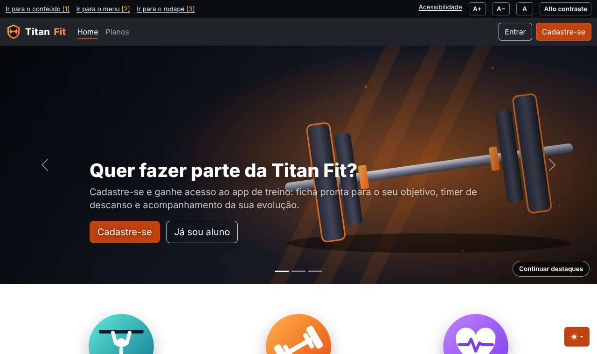
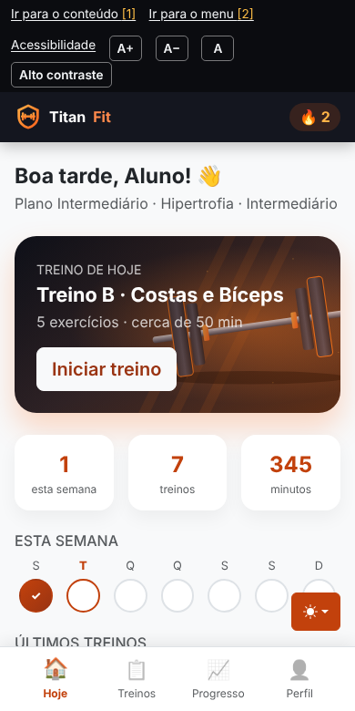
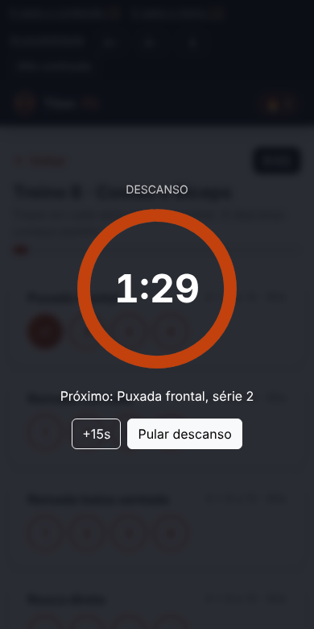
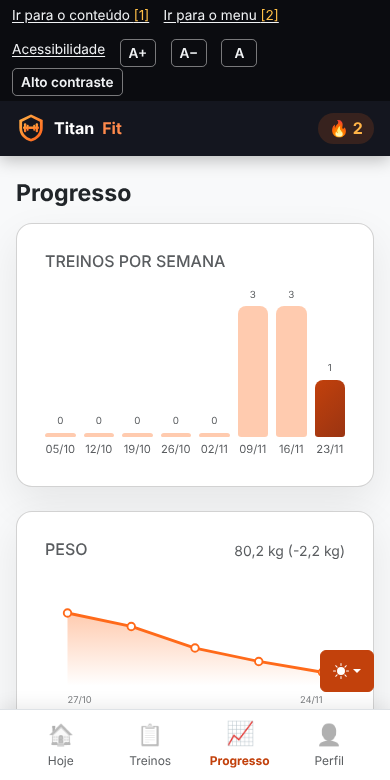
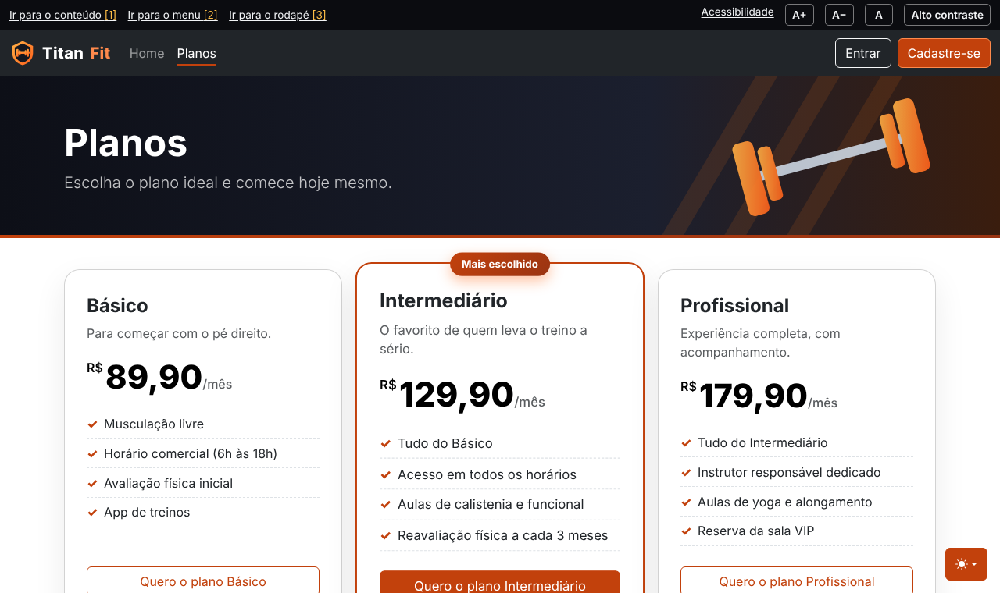
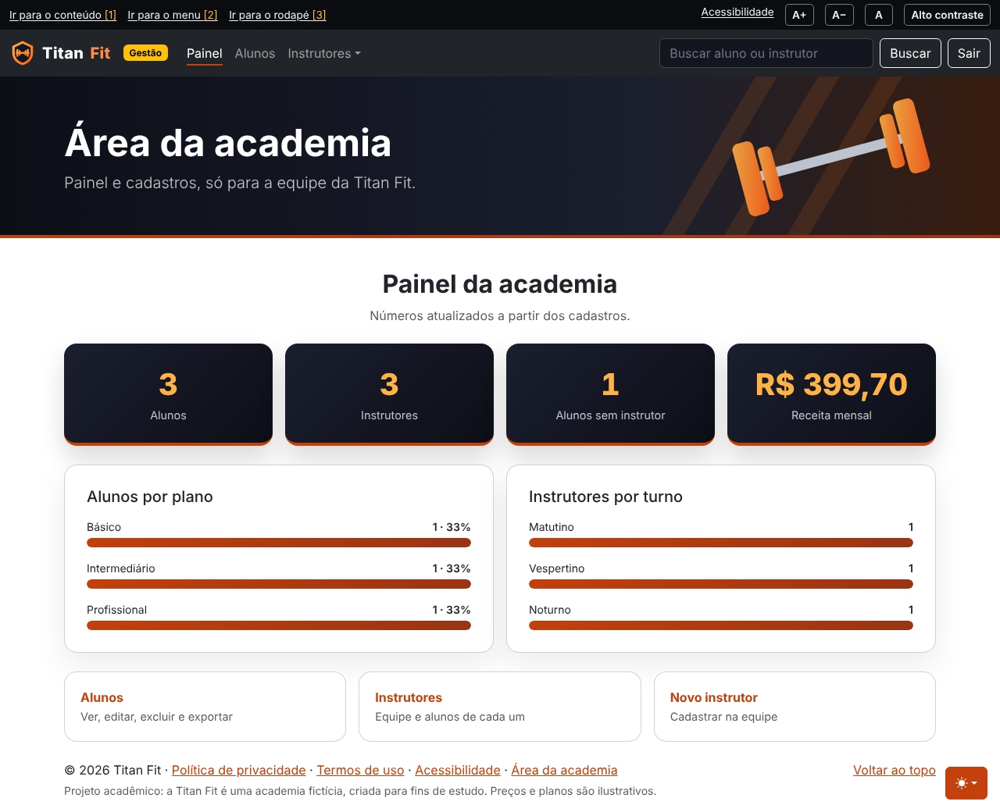
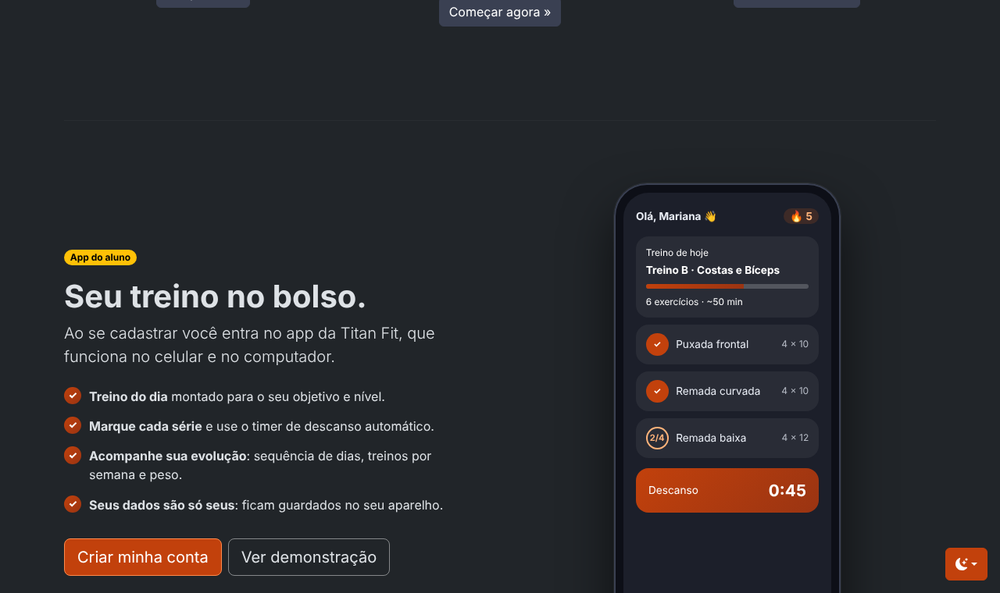
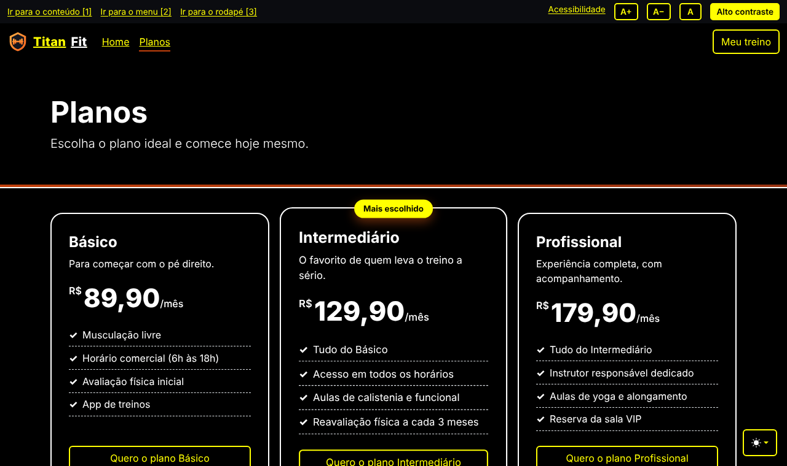

<div align="center">


# Titan Fit

**Site de academia com app de treino para alunos e área de gestão para a equipe.**

[**Acessar o site**](https://gegenevt-ux.github.io/Sistema_Gest-o_Academia/) ·
[Ver demonstração do app](https://gegenevt-ux.github.io/Sistema_Gest-o_Academia/entrar.html?demo=1) ·
[Acessibilidade](https://gegenevt-ux.github.io/Sistema_Gest-o_Academia/acessibilidade.html) ·
[Privacidade](https://gegenevt-ux.github.io/Sistema_Gest-o_Academia/privacidade.html)


</div>

> **Projeto acadêmico.** A Titan Fit é uma academia fictícia, criada para fins de estudo. Preços, planos e dados da empresa são ilustrativos.



## Sumário

- [Sobre o projeto](#sobre-o-projeto)
- [Funcionalidades](#funcionalidades)
- [Telas](#telas)
- [Acessibilidade](#acessibilidade)
- [Privacidade e leis](#privacidade-e-leis)
- [Como rodar](#como-rodar)
- [Estrutura de pastas](#estrutura-de-pastas)
- [Limites desta versão](#limites-desta-versão)
- [Próximos passos](#próximos-passos)
- [Autor](#autor)

## Sobre o projeto

O site tem três áreas:

| Área | Quem usa | O que tem |
| --- | --- | --- |
| **Pública** | Qualquer visitante | Página inicial, planos, cadastro e login |
| **App do aluno** | Aluno com conta | Treino do dia, timer de descanso, fichas, progresso e perfil |
| **Gestão** | Equipe da academia (com senha) | Painel, lista de alunos e de instrutores, edição e exportação |

Tudo é feito com **HTML, CSS, Bootstrap 5 e JavaScript puro**, sem servidor, e publicado no GitHub Pages.

## Funcionalidades

### Parte pública
- Página inicial com "Quer fazer parte da Titan Fit? Cadastre-se", modalidades e apresentação do app.
- Página de planos (Básico, Intermediário e Profissional). O botão de cada plano abre o cadastro com o plano já escolhido.
- Cadastro com validação de CPF, máscaras de CPF e telefone, objetivo, nível e senha.
- Login e **conta de demonstração**, para conhecer o app sem se cadastrar.

### App do aluno
- **Hoje:** treino do dia em divisão ABC, sequência de dias seguidos 🔥, semana marcada e histórico.
- **Treino em andamento:** o aluno toca em cada série e o **timer de descanso** começa sozinho, com aviso visual, sonoro, por vibração e para leitores de tela. No fim, tem comemoração. Se a página fechar, o treino continua de onde parou.
- **Treinos:** fichas A, B e C montadas de acordo com o objetivo (hipertrofia, emagrecimento ou condicionamento) e o nível.
- **Progresso:** gráfico de treinos por semana e evolução do peso.
- **Perfil:** dados com CPF oculto, ajuste de objetivo e nível, correção de dados, download dos dados, sair e excluir a conta.

### Gestão
- Acesso pelo link "Área da academia", no rodapé, protegido por senha criada no primeiro acesso.
- Painel com total de alunos e instrutores, alunos sem instrutor, receita mensal e gráficos por plano e por turno.
- Listas com busca, edição, exclusão e exportação para planilha (CSV, abre direto no Excel).
- Cadastro de instrutores, com a quantidade de alunos de cada um.

### Visual
- Ilustrações próprias em SVG, identidade em laranja e animações suaves.
- Tema claro, escuro ou automático.

## Telas

<table>
  <tr>
    <td width="33%"></td>
    <td width="33%"></td>
    <td width="33%"></td>
  </tr>
  <tr>
    <td align="center">Treino do dia</td>
    <td align="center">Timer de descanso</td>
    <td align="center">Progresso</td>
  </tr>
</table>

| Planos | Painel da gestão |
| --- | --- |
|  |  |

| Modo escuro | Alto contraste |
| --- | --- |
|  |  |

## Acessibilidade

O site segue a **Lei Brasileira de Inclusão** (Lei nº 13.146/2015), o **eMAG** e a **WCAG 2.2, nível AA**:

- Barra de acessibilidade em todas as páginas, com atalhos de teclado (**1** para o conteúdo, **2** para o menu, **3** para o rodapé), tamanho do texto (A+, A−, A) e **alto contraste**.
- Contraste mínimo de 4,5:1, foco sempre visível e navegação completa por teclado.
- Um título principal por página, imagens com texto alternativo e tabelas com legenda.
- Formulários com rótulos, campos obrigatórios marcados e erros anunciados para leitores de tela.
- Carrossel com botão de pausa e sem animações para quem prefere reduzir movimento.
- Tradutor de Libras **VLibras**, do Governo Federal.

Verificado com o [axe-core](https://github.com/dequelabs/axe-core) em 21 telas, nos temas claro, escuro e alto contraste, sem nenhum problema encontrado.

## Privacidade e leis

- **LGPD (Lei nº 13.709/2018):**
  - [Política de privacidade](https://gegenevt-ux.github.io/Sistema_Gest-o_Academia/privacidade.html) com a finalidade e a base legal de cada dado.
  - Aceite dos termos e confirmação de maioridade no cadastro, registrados com data.
  - Consentimento específico para o peso, que é dado de saúde, com opção de revogar.
  - Direitos do titular no app: acessar, corrigir, baixar os dados e excluir a conta.
  - CPF parcialmente oculto nas listas da gestão.
  - Senhas guardadas só como hash SHA-256 com sal, nunca em texto.
- **Código de Defesa do Consumidor (Lei nº 8.078/1990):** [Termos de uso](https://gegenevt-ux.github.io/Sistema_Gest-o_Academia/termos.html) com preços, cancelamento e direito de arrependimento.
- **Marco Civil da Internet (Lei nº 12.965/2014):** aviso sobre o armazenamento local, sem cookies de rastreamento.

## Como rodar

**On-line:** acesse <https://gegenevt-ux.github.io/Sistema_Gest-o_Academia/>.

**No computador:**

```bash
git clone https://github.com/gegenevt-ux/Sistema_Gest-o_Academia.git
cd Sistema_Gest-o_Academia
python3 -m http.server 8000
```

Depois, abra <http://localhost:8000> no navegador. Abrir o `index.html` direto também funciona, mas com um servidor local o login usa a criptografia do navegador (Web Crypto).

**Para testar:**
- **App do aluno:** clique em "Ver demonstração" na página inicial, ou crie uma conta.
- **Gestão:** clique em "Área da academia", no rodapé, e crie a senha no primeiro acesso.

## Estrutura de pastas

```
├── index.html                  Página inicial
├── planos.html                 Planos e preços
├── Cadastro_alunos.html        Cadastro do aluno (e edição pela gestão)
├── entrar.html                 Login e conta de demonstração
├── app.html                    App de treino do aluno
├── gestao.html                 Acesso da equipe e painel
├── listar_alunos.html          Gestão: alunos
├── listar_Instrutores.html     Gestão: instrutores
├── Cadastro_Instrutores.html   Gestão: cadastro de instrutor
├── privacidade.html            Política de privacidade (LGPD)
├── termos.html                 Termos de uso
├── acessibilidade.html         Recursos de acessibilidade
├── assets/
│   ├── dist/                   Bootstrap 5 (CSS e JS)
│   ├── img/                    Logo e ilustrações (SVG)
│   ├── js/
│   │   ├── app.js              Contas, cadastros, listas, painel, gestão e acessibilidade
│   │   ├── treino.js           App de treino do aluno
│   │   └── color-modes.js      Tema claro/escuro
│   └── style/                  Estilos do site
└── docs/img/                   Imagens deste README
```

## Limites desta versão

O site é estático (não tem servidor), então:

- Os dados ficam no **navegador de cada aparelho** (`localStorage`). Ninguém vê os dados de outra pessoa pela internet, mas um cadastro feito no celular não aparece no computador, nem na gestão de outro aparelho.
- As senhas separam as áreas no mesmo aparelho, mas não substituem a segurança de um servidor.

## Próximos passos

- [ ] Banco de dados on-line (por exemplo, Firebase ou Supabase), com login no servidor, para a academia ver todos os alunos.
- [ ] Instrutor montar fichas personalizadas para cada aluno.
- [ ] App instalável no celular (PWA), funcionando sem internet.

## Autor

Feito por **Getúlio Tavares** ([@gegenevt-ux](https://github.com/gegenevt-ux)).
